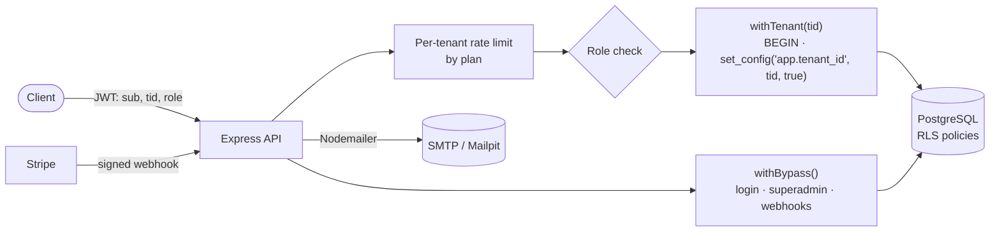
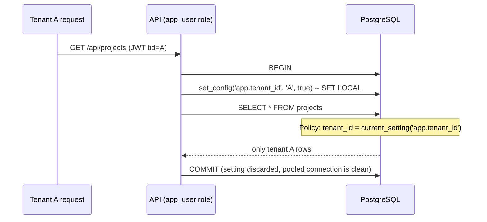

# Multi-Tenant SaaS Boilerplate

[](https://github.com/CH88320B/multi-tenant-saas-boilerplate/actions/workflows/ci.yml)


A production-ready starting point for **B2B SaaS backends**, built with Node.js, Express and PostgreSQL. Each customer (tenant) gets fully isolated data, enforced by **PostgreSQL row-level security**, along with:

- Role-based access
- Plan-based seat and **rate limits**
- **Stripe subscription billing**
- Transactional **email**
- **Swagger** docs

## Features

- **Tenant isolation at the database level**: RLS policies filter every query by the tenant bound to the transaction, so a forgotten `WHERE tenant_id = …` can't leak data
- **Roles**: `superadmin` (platform operator, cross-tenant), `admin` (manages their tenant) and `user`
- **Self-service signup**: creates a tenant and its first admin atomically
- **Team management**: invite users (emailed a temporary password), change roles, remove members, with seat limits per plan
- **Stripe billing**:
  - Subscription checkout and customer portal
  - Signed, idempotent webhooks that upgrade or downgrade the tenant plan and email the admins
- **Per-tenant rate limiting**: every user of a tenant shares a budget sized by plan (free 60, pro 600, enterprise 3000 req/min)
- **Email** with Nodemailer: welcome, invitation and plan-change templates. Mailpit catches everything locally
- **OpenAPI 3 + Swagger UI** at `/docs`
- **Integration tests against real PostgreSQL**, proving isolation (cross-tenant reads, smuggled `tenant_id`, raw queries with no context)

## Architecture



### How isolation works



- The API connects as **`app_user`**, a non-owner role, so policies always apply. Migrations run as the owner.
- `SET LOCAL` scopes the tenant to a single transaction, so pooled connections can't carry one tenant's context into another request.
- `projects.tenant_id` defaults to the transaction's tenant, so clients can't choose it.
- To add a tenant-owned table, copy the `projects` pattern: a `tenant_id` column with that default, `ENABLE ROW LEVEL SECURITY`, and one policy.

## Getting started

```bash
cp .env.example .env
docker compose up -d db mailpit
npm install
npm run migrate
npm run seed:superadmin -- ops@example.com "Ops" 'a-very-strong-password'
npm run dev
```

| URL | What |
|-----|------|
| http://localhost:3000/docs | Swagger UI |
| http://localhost:8025 | Mailpit (captured emails) |

Or run everything in containers with `docker compose up --build`.

### Try it

```bash
TOKEN=$(curl -s -X POST localhost:3000/api/auth/signup -H 'Content-Type: application/json' \
  -d '{"company":"Acme Inc","slug":"acme","name":"Jane","email":"jane@acme.com","password":"password123"}' | jq -r .token)

curl -X POST localhost:3000/api/projects -H "Authorization: Bearer $TOKEN" -H 'Content-Type: application/json' -d '{"name":"Q3 launch"}'
curl -X POST localhost:3000/api/users -H "Authorization: Bearer $TOKEN" -H 'Content-Type: application/json' -d '{"email":"dev@acme.com","name":"Dev"}'
```

### Stripe

1. Create **Pro** and **Enterprise** recurring prices, and put their IDs in `.env`.
2. Forward webhooks locally with `stripe listen --forward-to localhost:3000/api/billing/webhook`.
3. `POST /api/billing/checkout {"plan":"pro"}` returns a Checkout URL. When the subscription activates, the webhook upgrades the tenant.

### Tests

```bash
docker compose up -d db
npm test
```

## Plans

| | Free | Pro | Enterprise |
|---|---|---|---|
| Seats | 3 | 25 | Unlimited |
| API requests / min (per tenant) | 60 | 600 | 3000 |

Both are configured in `src/config.js`.

## Project structure

```
migrations/        SQL migrations (tables, RLS policies, app role)
scripts/           migrate, create-superadmin
src/
├── db.js          pool, withTenant(), withBypass()
├── middleware/    auth (JWT + roles), tenant rate limit, errors
├── routes/        auth, tenant (users, projects), billing, admin
└── services/      mailer (templates)
docs/openapi.yaml  API contract served at /docs
tests/             integration tests against PostgreSQL
```

## License

[MIT](LICENSE)
